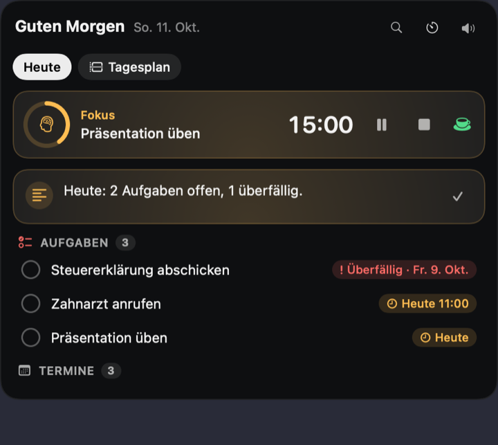
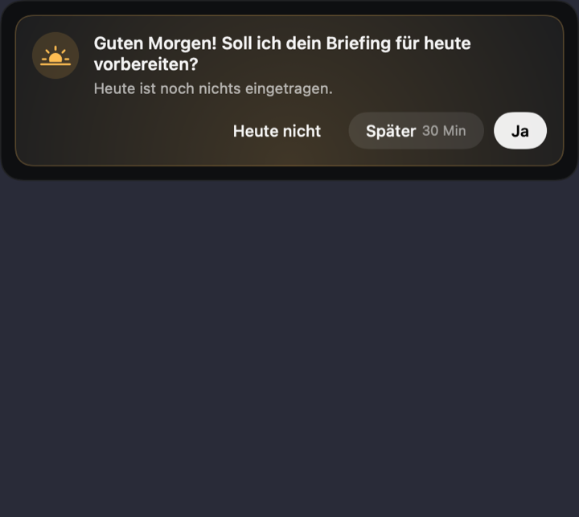
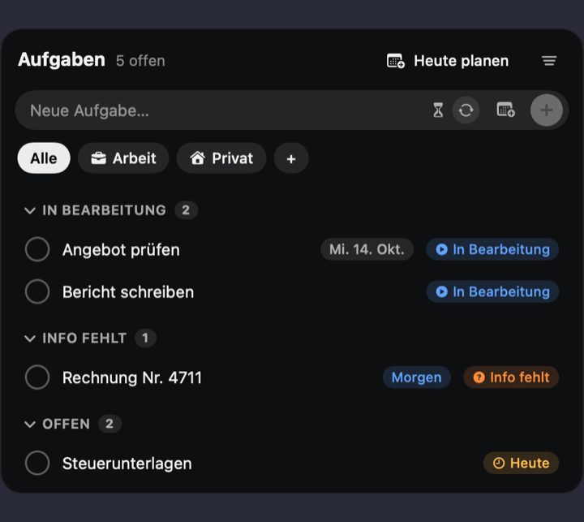
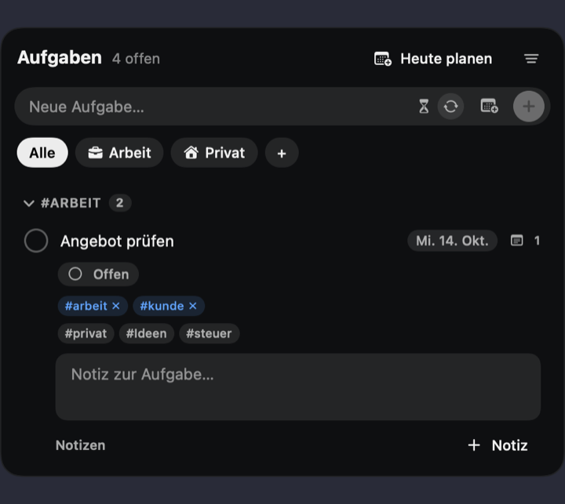
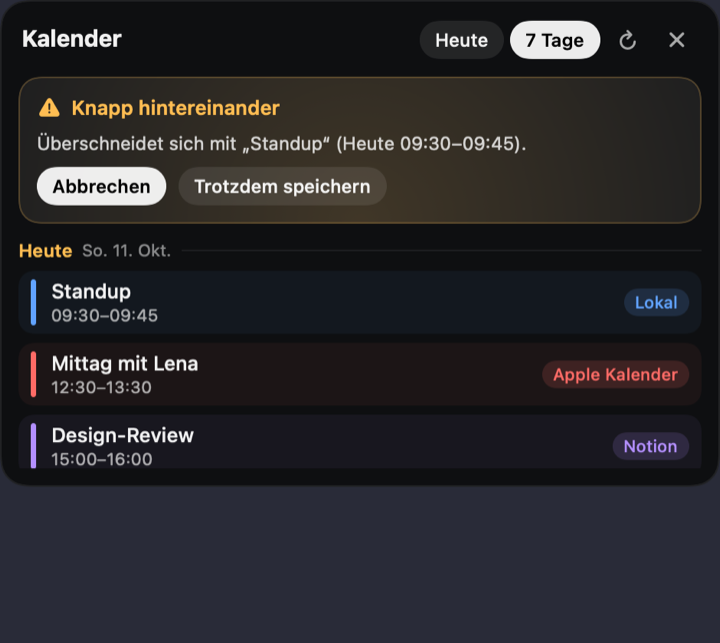
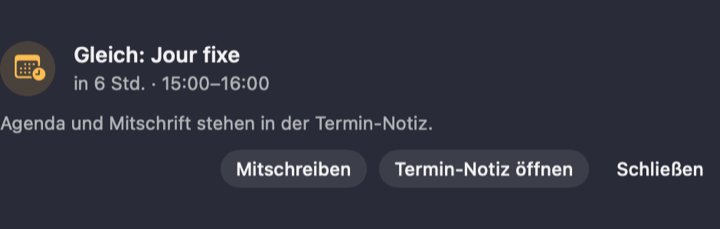
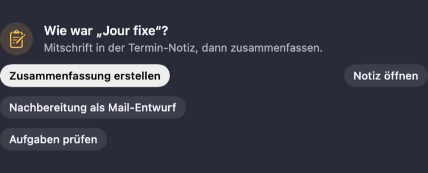
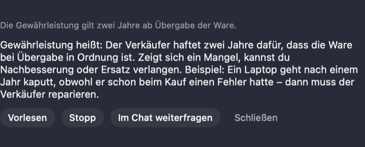
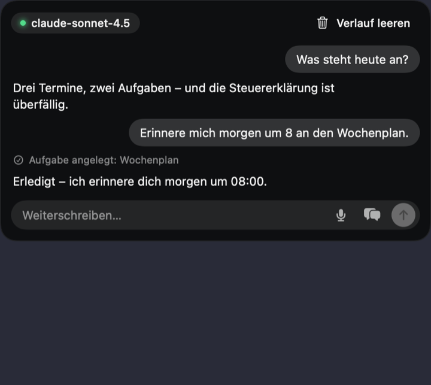
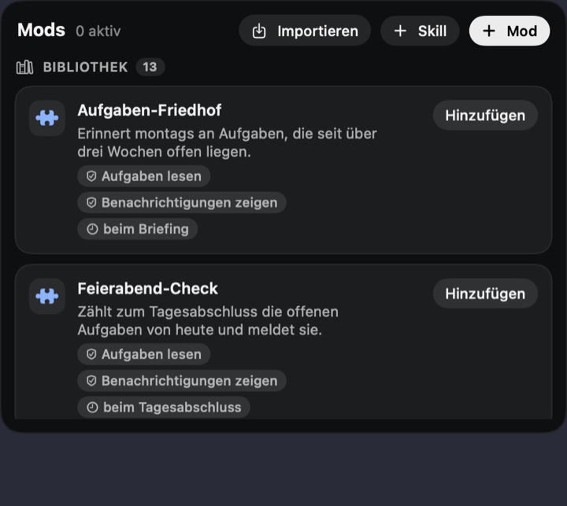

# Lumi – was sie kann

**Einrichtung:** Beim ersten Start führt ein Assistent durch Zugang, Kalender, Mitteilungen und Kurzbefehle. Er kommt bei jedem Start wieder, bis du ihn abgeschlossen hast. „Später“ schließt nur das Fenster, „Nicht mehr anzeigen“ beendet ihn dauerhaft. Wieder öffnen: **Einstellungen → Allgemein → „Einrichtung öffnen“** oder Lumi-Symbol in der Menüleiste → Einrichtung.

**Die Notch-Leiste:** Die Reiter sind in Gruppen geordnet: *Täglich* (Heute, Chat) · *Planen* (Aufgaben, Kalender, Notizen) · *Kommunikation* (Mail, Nachrichten) · *Extras* (Musik, Agenten, Mods, Notion, Netzwerk) · Einstellungen. Der aktive Reiter zeigt seinen Namen, bei den anderen erscheint er als Tooltip. Welche Reiter sichtbar sind und in welcher Reihenfolge, stellst du unter **Einstellungen → Notch → „Reiter in der Notch“** ein; ausgeschaltete liegen unter „Mehr“ (dort auch „Reiter anordnen …“).

Lumi sitzt in der Notch deines MacBooks. Ein Klick öffnet die Insel mit allen Bereichen,
unten rechts steht der Chat. Alles Wichtige (Konflikte, Erinnerungen, Tagesstart) ist
Code und läuft auch ohne Modell und ohne Netz; das Modell formuliert nur und bedient Werkzeuge.

> Die Bilder sind mit Beispieldaten gerendert, nicht von einem echten Konto.

## Heute und Fokus

- **Heute:** offene und überfällige Aufgaben, Termine, ein kurzer Satz zum Tag.
- **Fokus:** Timer pro Aufgabe oder frei (Standard 25 Min). **Pause** hält ihn an,
  der Fokus läuft danach weiter; der Kaffee-Knopf startet eine spontane Pause.
- **Jetzt beginnen:** Auf eine Aufgabe tippen und „Jetzt beginnen“ wählen. Lumi nimmt
  die eingestellte Dauer, schiebt die späteren Aufgaben nach hinten und ändert dabei
  wirklich deren Fälligkeit.
- **Zeit überschritten?** Lumi fragt „Fertig oder noch Zeit?“. Mit „Noch Zeit“ stellst du
  15/30 Min oder eine eigene Dauer ein, der Rest passt sich an.
- **Vorlesen:** Das Lautsprecher-Symbol oben liest Termine und offene Aufgaben vor. Während Lumi spricht, wird es zum **Stopp**-Knopf (Quadrat); ein Tipp beendet die Ansage sofort.
- **Aufgaben auf „Heute“:** Die Abschnitte **Aufgaben** und **Termine** lassen sich über den Pfeil rechts im Kopf ein- und ausklappen (Lumi merkt sich die Wahl). Jede Aufgabe hat dieselben Möglichkeiten wie im Reiter „Aufgaben“: antippen klappt Stand, **Dauer**, **Neu planen**, Kennzeichen und Notizen auf; beim Darüberfahren erscheinen Fokus starten (▶), Priorisieren (★), Bearbeiten (✎ – Titel, Fälligkeit, Wiederholung) und Löschen.
- **Tagesstart und Feierabend** fragen dich vorher, ob sie loslegen sollen.

## Aufgaben

- Beim Anlegen gleich **Dauer**, Kategorie, Fälligkeit, Wiederholung.
- **Stand:** Offen · In Bearbeitung · Info fehlt (abgeschlossen = abgehakt).
- **Kennzeichen** (#arbeit, #kunde …) an Aufgaben und Notizen.
- **Ansicht-Menü** (rechts oben): gruppieren nach Keine / Kategorie / Stand / Kennzeichen,
  filtern nach Stand und Kennzeichen, „Zurücksetzen“. Deine Wahl bleibt gespeichert.

- **Notion-Stände zuordnen:** Unter **Einstellungen → Konten → „Notion-Stände zuordnen“** (sichtbar, sobald Notion-Aufgaben da sind) legst du fest, was jeder Notion-Stand in Lumi bedeutet: *Automatisch* (Lumi schlägt vor, z. B. „In progress“ → In Bearbeitung, „Warten“ → Info fehlt, „Not started“ → Offen), *Offen*, *In Bearbeitung*, *Info fehlt* oder *Nicht ändern*. Lumi übernimmt den Stand beim Abgleich, wenn er sich in Notion ändert; eigene Änderungen in Lumi bleiben bis dahin bestehen.
- **Filter „Quelle“ und „Fällig“:** Im Ansicht-Menü gibt es zusätzlich *Quelle* (Aus Notion / Eigene) und *Fällig* (Überfällig, Heute, Morgen, Diese Woche, Ohne Datum). Alles ist kombinierbar: mehrere Auswahlen in einer Gruppe gelten als „oder“, verschiedene Gruppen als „und“ (z. B. Aus Notion + Offen + Morgen).
- **Tastenkürzel:** Alle Kürzel, auch *Markierten Text erklären* (Ctrl+Option+E) und *Einkreisen und fragen* (Ctrl+Option+K), stehen unter **Einstellungen → Tastenkürzel** und lassen sich ändern. Eine Kombination, die eine andere App schon belegt, wird rot angezeigt.

## Notizen

- Kleiner Editor mit **Überschriften, Fett/Kursiv, Listen, Checkboxen, Zitat, Trennlinie**
  (Markdown, Leiste über dem Feld, ⌘B / ⌘I).
- Notizen hängen an Aufgaben oder Terminen und lassen sich in ein eigenes Fenster lösen.
- Gehört eine Notiz zu einer Aufgabe, siehst du deren Stand direkt in der Notiz.

## Kalender und Konflikte

Apple Kalender, ICS, Notion und Microsoft in einer Ansicht. Beim Anlegen prüft **Lumi im Code**
auf Überschneidungen und knappe Abstände und fragt, bevor sie etwas doppelt belegt.

## Meetings

**Immer erreichbar:** Im Reiter **Heute** steht der Abschnitt **Meeting**. Er zeigt den laufenden oder nächsten Termin (antippen für Vorbereiten und Mitschreiben) und den Knopf **Spontan mitschreiben** für Gespräche ohne Kalendertermin. Zusätzlich erscheint 10 Minuten vor einem Termin automatisch eine Karte.

- **Vor dem Termin:** Lumi fragt, ob du eine Termin-Notiz brauchst, und legt eine Agenda
  mit Stichpunkten an (Kennzeichen inklusive).
- **Mitschreiben (lokal):** „Nur ich“ (Mikrofon) oder „Alle“ (Mikrofon + Ton der anderen).
  Bei „Alle“ startet es erst, wenn du bestätigst, dass alle informiert und einverstanden sind;
  Lumi gibt dir einen Satz zum Kopieren für den Call-Chat. Die Erkennung läuft nur auf dem
  Gerät, gespeichert wird **nur Text, nie Ton**. Ein roter Punkt in der Notch zeigt, dass es läuft.
- **„Aufgabe!“** sagen oder drücken markiert eine Stelle als Aufgabe.
- **Aufgaben aus dem Gespräch:** Nichts wird ungefragt angelegt. „Sicher“ (vorgewählt) und
  „Unklar – bitte entscheiden“, jede mit wörtlichem Zitat. Das Datum rechnet der Code.

- **Danach:** Zusammenfassung, Nachbereitung als Mail-Entwurf, Aufgaben prüfen.

## Erklären

Text in irgendeiner App markieren und **Ctrl+Option+E** drücken (braucht die Bedienungshilfen-Freigabe) – oder ohne Freigabe: **Rechtsklick → Dienste → „Mit Lumi erklären“**. Dann wächst die Karte mit der Erklärung mit (lange Texte scrollen darin). Unten stehen **Vorlesen**, **Stopp**, **Im Chat weiterfragen**, **Schließen** und eine **Nachfragen …**-Zeile: Return schickt deine Frage samt markiertem Text in den Chat. Dann: Lumi erklärt kurz, liest auf
Wunsch vor und lässt dich im Chat weiterfragen. Das Modell bekommt dafür keine Werkzeuge.
Im Fokus, im Termin und beim Mitschreiben bleibt Lumi still.

### Antwort entwerfen

In der Erklär-Karte steht der Knopf **Antwort entwerfen**. Lumi schreibt dann aus dem markierten Text (z. B. einer Kundenanfrage) einen Antwortentwurf in der Sie-Form: Dank, Verständnis, Antwort, Lösung, Tipp. Was fehlt (Preis, Frist, Nummer), steht als **[Platzhalter]**; Lumi erfindet nichts. Die Grußformel am Ende stellst du unter **Einstellungen → Sprache & Assistent → „Grußformel für Antwortentwürfe“** ein (leer = „Freundliche Grüße“). Unter dem Entwurf: **Kopieren**, **Als Mail-Entwurf** (öffnet ein neues Mail-Fenster, gesendet wird nie von selbst) und **Erklärung zeigen**.

### Einkreisen und per Sprache fragen

1. **Ctrl+Option+K** drücken. Der Bildschirm wird abgedunkelt.
2. Den Bereich mit Maus, Trackpad oder Grafiktablett einkreisen (oder ein Rechteck aufziehen). **Esc** bricht ab.
3. Lumi liest den Text im Ausschnitt (Texterkennung nur auf dem Mac, das Bild verlässt den Mac nicht) und hört zu: z. B. „Was ist das?“ oder „Erklär mir das“. Nach einer kurzen Pause (oder ohne Frage nach ca. 8 Sekunden) antwortet Lumi in der Karte; Vorlesen, Nachfragen und **Antwort entwerfen** gehen wie beim Erklären.
4. **Freigaben (einmalig):** Systemeinstellungen → Datenschutz & Sicherheit → **Bildschirmaufnahme** (Lumi), dazu Mikrofon und Spracherkennung. Danach Lumi einmal neu starten, falls macOS das verlangt.
- Grenzen: Lumi liest nur Text im Ausschnitt; Fotos und Diagramme ohne Text deutet sie noch nicht. Ein Apple Pencil funktioniert am Mac nicht.

## Chat

Frei wählbares Modell (OpenRouter) oder Apple Intelligence. Lumi legt Aufgaben, Notizen und
Termine an, fragt bei Wichtigem nach und sagt, was sie getan hat.

## Musik – Dienste einbinden

Der Reiter **Musik** (Notch → „Musik“, ggf. unter „Mehr“) zeigt den laufenden Titel, eine Suche und eine schmale Dienst-Auswahl. Alles zum Verbinden und Einrichten steht unter **Einstellungen → Musik** (das Zahnrad im Reiter öffnet sie). Der Reiter lässt sich unter Einstellungen → Allgemein verschieben und ausblenden.

### Player (im Musik-Reiter und oben auf „Heute“)
- Auch auf der Startseite (**Heute**) sitzen rechts neben „Heute / Tagesplan“ immer die Knöpfe **Zurück, Pause, Weiter**, damit Musik schnell aus geht. Der Titel erscheint darunter in einer schmalen Zeile, solange etwas läuft; ein Tipp darauf öffnet den Musik-Reiter.
- Oben im Musik-Reiter steht immer der Player mit **Zurück, Pause/Abspielen, Weiter**.
- Bei Spotify und Apple Musik zeigt er den laufenden Titel.
- Läuft etwas anderes (z. B. **YouTube im Browser**), steuern die Knöpfe das, was im System gerade abspielt, wie die Mediatasten der Tastatur. Dafür braucht Lumi die **Bedienungshilfen-Freigabe** (Systemeinstellungen → Datenschutz & Sicherheit → Bedienungshilfen → Lumi). Ohne sie zeigt Lumi einen Hinweis.
- **YouTube-Titel anzeigen:** In den Musik-Einstellungen den Schalter **„YouTube im Browser anzeigen“** einschalten. Lumi liest dann beim Öffnen von Heute/Musik die Tab-Titel von Safari, Chrome, Brave oder Edge und zeigt nur den Titel des YouTube-Tabs. macOS fragt einmal je Browser nach der Automation-Freigabe (Datenschutz & Sicherheit → Automation). Standardmäßig ist das aus. Ob das Video gerade läuft oder pausiert ist, sieht Lumi dabei nicht; das Symbol (Play/Pause) folgt nur deinem Druck auf Pause in Lumi.

### Liedtext und Effekt (optional, Einstellungen → Musik)
- **Liedtext anzeigen** (standardmäßig aus): Im Musik-Reiter erscheint ein Knopf „Liedtext“, der den Text aufklappt. Dafür werden Interpret und Titel an lrclib.net gesendet.
- **Effekt** (Aus, Balken, Wellen, Glühen): ein dezenter Effekt hinter dem Titel, solange etwas spielt. Reine Optik, keine echte Audioanalyse; bei „Bewegung reduzieren“ steht er still.
- **Wunsch-Dienst**: welcher Dienst beim Öffnen der Musikseite gewählt ist.

### Spotify (Anmeldung, Suche, Playlists, Abspielen)
1. Auf <https://developer.spotify.com/dashboard> mit deinem Spotify-Konto anmelden und **„Create app“** wählen (Name frei, z. B. „Lumi“; bei „APIs“ die **Web API** ankreuzen).
2. Bei **Redirect URIs** genau `http://127.0.0.1:8898/callback` eintragen (in Lumi steht sie mit „Kopieren“-Knopf) und speichern.
3. In den App-Einstellungen die **Client-ID** kopieren, in Lumi unter Einstellungen → Musik einfügen, **Speichern**, dann **Verbinden**.
4. Der Browser öffnet die Spotify-Seite; **Zustimmen**. Danach steht in Lumi „Verbunden“.
5. Abspielen braucht **Spotify Premium** und die **Spotify-App auf dem Mac** (einmal geöffnet, ein Titel gestartet).
- Lumi speichert nur die öffentliche Client-ID; das Anmelde-Token liegt im Schlüsselbund. **Trennen** löscht es.

### Apple Musik
- Keine Anmeldung in Lumi: Lumi steuert die **Musik-App**, in der du bei Apple angemeldet bist.
- Beim ersten Zugriff fragt macOS nach der Automation-Freigabe (Systemeinstellungen → Datenschutz & Sicherheit → Automation → Lumi → Musik).
- Du siehst deine Playlists und kannst in deiner **Bibliothek** suchen; eine Suche im gesamten Apple-Katalog gibt es nicht.

### YouTube, YouTube Music, Amazon Music
- Diese Dienste haben keine offizielle Schnittstelle zum Anmelden und Steuern. Lumi öffnet die **Suche im Browser** (oder in der App). Melde dich dort wie gewohnt an (YouTube Premium, Amazon Music Unlimited).
- Lumi öffnet dabei nur Adressen von youtube.com, music.youtube.com und music.amazon.* .

## Verbindungen und Mods

- **Nachrichten:** iMessage, Slack, Element/Matrix, Apple Mail (Antworten gehen nur an die
  bestätigten Empfänger).
- **Notion:** mehrere Quellen, Abhaken geht zurück nach Notion.
- **Mods:** eigene Skripte und eine Bibliothek fertiger Mods (z. B. Wetter in der Notch).
- **Agents:** Claude-Code-Anfragen erscheinen in der Insel zur Freigabe.

## Umzug auf einen anderen Mac (Export und Import)
Deine Daten liegen in `~/Library/Application Support/de.felix.taby/`, nicht in der App. Lumi neu installieren oder aktualisieren (App ersetzen) behält alles; neu anfangen würdest du nur, wenn du diesen Ordner löschst.

**Mitnehmen auf einen anderen Mac:**
1. Alter Mac: Einstellungen → Allgemein → **Sicherungen** → **Alles exportieren …**, Ordner wählen (USB-Stick, iCloud Drive). Es entsteht eine Datei `taby-….sqlite` mit Notizen, Aufgaben, Habits, Terminen und Gedächtnis.
2. Datei auf den neuen Mac kopieren. Dort dieselbe oder eine neuere Lumi-Version installieren.
3. Neuer Mac: Einstellungen → Allgemein → Sicherungen → **Aus Datei importieren …**, Datei wählen, bestätigen. Lumi sichert vorher den aktuellen Stand und startet neu.

**Nicht enthalten:** Schlüssel und Anmeldungen liegen im Schlüsselbund (OpenRouter, Notion, Spotify, Microsoft). Am neuen Mac unter Einstellungen neu verbinden. Auch Kalender-Freigaben und Ordner-Pfade (Vault, Export) musst du dort neu setzen.

## Datenschutz

- Daten bleiben auf dem Mac, Schlüssel nur im Schlüsselbund.
- Mitschrift: nur Text, Erkennung auf dem Gerät, kein Rückfall auf die Cloud.
- Mit lokalem Modus (Apple Intelligence) verlässt nichts den Mac.

Installation: siehe [download/Anleitung.txt](../download/Anleitung.txt).
